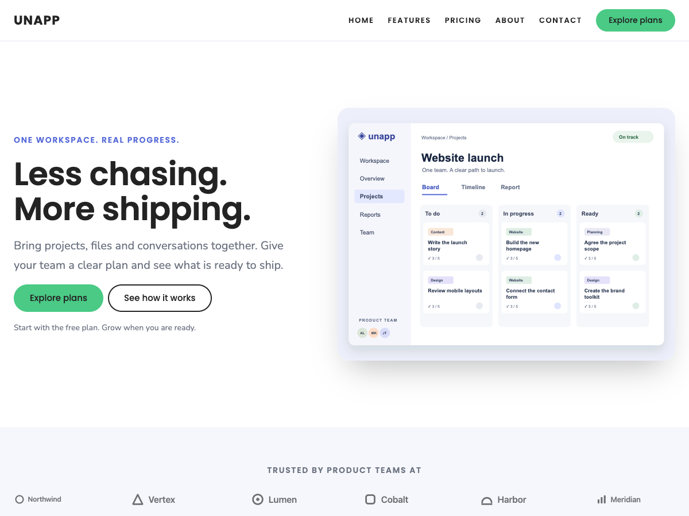

# Unapp

Unapp is a free, lightweight WordPress **block theme** for local businesses, creators, shops and startups by [Colorlib](https://colorlib.com). Version 2.0 is a ground-up rewrite for the Site Editor: no page-builder framework, no jQuery, no icon fonts — just core blocks, `theme.json` and patterns.



## Starter sites

Appearance → **Starter Sites** applies a complete design for one kind of website — palette, typeface, home page, supporting pages and menu:

| Starter | Look | Creates |
|---|---|---|
| SaaS & app | Indigo · Poppins & Nunito | Home, Features, Pricing, About, Contact |
| Portfolio | Mono · Inter | Home, Work, About, Contact |
| Church | Stone · Fraunces & Inter | Home, Plan your visit, About us, Give, Contact |
| Blog & magazine | Sunset · Fraunces & Inter | Home, About, Contact |
| Fitness studio | Ember · Manrope | Home, Timetable, Memberships, Contact |
| Finance & advisory | Navy · Fraunces & Inter | Home, Services, About, Contact |
| Restaurant | Harvest · Fraunces & Inter | Home, Menu, The kitchen, Book a table |
| Agency | Slate · Space Grotesk & Inter | Home, Work, Studio, Start a project |
| Shop | Emerald · Manrope | Home, How it is made, Delivery and returns, New in |
| Property | Graphite · Fraunces & Inter | Home, For sale, Our fees, Book a valuation |
| Practice | Slate · Inter | Home, Treatments, The team, Find us |
| Courses | Violet · Poppins & Nunito | Home, Courses, Tutors, Contact |
| Conference | Midnight · Space Grotesk & Inter | Home, Programme, Tickets, Venue and access |
| Home Services | Navy · Fraunces & Inter | Home, Services, Where we work, Request a quote |
| Cleaning | Emerald · Inter | Home, Cleaning services, Areas and visits, Get a quote |
| Salon & Barber | Harvest · Fraunces & Inter | Home, Services, Visit the studio, Appointments |
| Coach & Consultant | Slate · Inter | Home, Work together, The approach, Start a conversation |
| Photographer | Mono · Inter | Home, Selected work, The approach, Enquiries |
| Nonprofit | Stone · Fraunces & Inter | Home, Programmes, About our work, Ways to support, Get involved |

Find a starter by niche or category: searches such as **electrician**, **barber**, **coaching**, **photography** and **charity** find suitable foundations. The finder works without JavaScript and shows required plugins clearly. All nineteen bundled starters are free and use native blocks; the six newer niche starters need no plugins. Their contact pages use email links by default and support the optional form selector.

The **Launch checklist** flags unfinished starter content and links to the pages that need editing. Choose a specific contact form or email-only contact there, then record your content, delivery and mobile reviews. A separate **Recommended checks (optional)** panel covers the site icon, saved navigation destinations, search visibility and image descriptions. These suggestions never affect launch progress or change settings automatically.

Preview a starter at desktop, tablet or mobile width before applying it. The wizard personalizes sample emails and phone numbers, and **Undo this setup** restores the prior site settings and design while protecting later edits.

Start with the recommended **One-page website**, or choose a full site. Optional colors and typography keep their starter defaults. **Appearance → Business profile** updates shared public details while preserving fields edited directly in WordPress. Add supporting pages later without rebuilding the homepage or design; custom navigation stays intact.

Compatible service-based starters offer **Personalize service cards (optional)** in setup and Business profile. Enter real names and descriptions once to fill native cards on the homepage and supporting pages, including pages added later. Blank rows retain existing copy; prices, images and actions are preserved. Direct edits in WordPress take priority over later shared updates.

**Appearance → Finish your website** brings business details, branding, homepage editing, contact setup and launch checks together with a suggested next step. Choose a main call, email, booking, quote or shop action for generated header and homepage buttons. Direct edits and secondary links are preserved; buttons stay native WordPress blocks.

Choose optional homepage sections during setup to reduce demo content and keep section links working. The **Guided content pass** follows your homepage and imported supporting pages, with separate progress for each page and section. Open a section or an individual image in the native editor, replace photos through the Media Library, and review crop, image size and alternative-text guidance. Bundled demo images are labeled; editing a section resets its review while preserving other progress. Guided editor visits include native notice shortcuts to review the section, return to setup or move to the next section. Save changes first; the shortcuts never approve a review for you.

For compatible heroes, services grids and calls to action, **Try another section layout** previews alternatives using your saved content. Choose image-left/right or stacked heroes, one/two/three-column services, and stacked or side-by-side actions. Apply only the selected section; **Undo last section swap** restores it while protecting newer edits. Text, images, links and buttons stay native WordPress blocks.

Before applying a starter, the **personalized homepage preview** shows the chosen sections, public details, logo, colors, typography and main action at desktop, tablet and mobile widths. Preview and import share the same content generation. The preview is private and leaves the live site unchanged; external actions and submissions are inactive.

Appearance → **Make it yours** brings together native WordPress controls for your logo, site identity, colors, fonts, buttons and menus. Preview three header and three footer layouts at different widths before applying one. Presets save ordinary template parts, preserve the menu and logo where supported, and include a guarded Undo for the latest change. Continue editing every block in the Site Editor.

Every starter carries its own patterns end to end — its home page, its inner pages and its footer. A church site does not sign off with SaaS pricing links, and its Contact page does not answer questions about free trials.

Add your own with the `unapp_starter_sites` filter. No page, post or image is deleted when you apply or switch; the styles, header and footer a starter replaces are kept as revisions.

## Starter library plugin

`plugin/unapp-library/` adds starter sites from JSON packs, so a new vertical
ships without a theme release. A pack carries its own patterns as block markup;
switching it on under Appearance → Starter Library adds it to the starter
screen. The bundled Charity pack demonstrates it — twenty starters with the
plugin active, nineteen without.

## Updates

The theme is distributed outside WordPress.org and updates through the hook
core added for that in 6.1 — an `Update URI` header plus
`update_themes_{hostname}` — so releases appear in Dashboard → Updates like any
other theme. `docs/updates.md` documents the endpoint contract, exactly what
the check sends, and the two filters that trim or disable it.

## Design system

Every section is built from the same measurements, held in one place (`.dev/pgen.py`) and enforced by the generator:

| | |
|---|---|
| Section padding · gap | `70` / `60` on the theme's spacing scale |
| Card padding · gap · radius | `50` / `30` / `20px` |
| Grid gutter · stacked blocks | `40` / `30` |
| Radii in the whole theme | `14px` badges, `20px` cards and images, `999px` pills |
| Reading column · intro column | `760px` / `680px` |

Spacing that is not on the scale is refused at build time, sections alternate their ground by role (explanation on the page ground; proof, prices, answers and contact on the tinted one), and where two same-ground sections meet a hairline seam separates them. The repository audits check heading structure, section-ground rhythm, contact destinations and text contrast across all palettes. Browser keyboard regressions run in CI; see `.dev/README.md` for the commands.

## Highlights

- **Complete landing page on activation** – a real "Home" page (editable page content, *Page (No Title)* template) and a "Blog" page are created and assigned in Settings → Reading; this happens automatically only on a fresh install, and a site with existing content gets a one-click notice instead. Gradient hero with product screenshot, services grid, image & text, features around a phone, animated stats, screenshot gallery (core lightbox), pricing table, team, latest posts, call to action and contact cards.
- **232 inserter patterns and 19 niche starter sites**, grouped into native inserter categories (Heroes, Features, Social proof, Pricing, Calls to action, Content & blog, Company, Utility, Portfolio, Church, Fitness, Finance, Blog & magazine, Full pages).
- **Section styles** for Group/Columns/Column: Card, Soft background, Dark, Gradient, Frosted glass, Outline, Elevated. **Block styles**: List (Checklist, Dashed, Numbered steps, Two columns), Image (Device frame, Browser frame, Framed), Quote (Testimonial card), Details (FAQ card), Table (Comparison), Separator (Gradient line), Button (Text link with arrow), Columns (Divided).
- **Mix-and-match styles**: 12 colour palettes × 5 typography presets = 60 combinations, plus 12 curated looks. Colour and typography are separate partials in `styles/colors/` and `styles/typography/`.
- **Performance**: six self-hosted font families (woff2, latin + latin-ext subsets, ~530 KB total, only the active pair downloads), AVIF images, fluid type, small scripts loaded where their controls or counters are used, per-block CSS loaded on demand.
- **Security**: escaped pattern output and direct-file guards. Fonts and images are local; automatic update checks make the documented requests described in `docs/updates.md`.

## Requirements

- WordPress 6.6+ (theme.json v3, section styles) — tested up to 7.1
- PHP 7.4+

## Structure

```
unapp/
├── style.css            theme header + a few rules theme.json can't express
├── theme.json           palette, gradients, shadows, spacing, fonts, global styles, templates
├── functions.php        block styles, pattern categories, lazy counter script
├── inc/front-page-setup.php  Home/Blog page creation + Reading settings on activation
├── inc/starter-sites.php     nineteen starter sites and the finder screen
├── templates/           index, home, single, page, page-no-title, archive, author, category,
│                       tag, date, search, 404, page-with-sidebar, single-with-sidebar
├── parts/               header, footer, sidebar (each references a PHP pattern for i18n)
├── patterns/            generated sections, page starters and hidden template partials
├── styles/              curated looks, colors/ and typography/ partials, section styles
├── assets/css/          per-block styles (checklist, device frame)
├── assets/js/counter.js stat counter (IntersectionObserver, reduced-motion aware)
├── assets/fonts/        six self-hosted font families (OFL)
├── assets/images/       AVIF screenshots/photos, 55 SVG icons, avatars, logo marks, star ratings
└── languages/unapp.pot  translation template
```

## Customising

- **Colors / fonts / spacing** – Appearance → Editor → Styles, or edit `theme.json`. Add a palette variation by dropping a JSON file into `styles/`.
- **Header / footer** – Appearance → Editor → Patterns → Template Parts, or update their generator sources (the parts reference translatable patterns).
- **New section** – extend the generators to emit `patterns/my-section.php` with a `Slug: unapp/my-section` header and the `unapp` category; escape every string with `esc_html_e()` / `esc_attr()` / `esc_url()`.
- **Section look** – select any Group and pick Card / Soft background / Dark / Gradient under Styles. Add more by creating `styles/section-*.json` with `"blockTypes"`.

## Front page behaviour

There is deliberately **no `front-page.html`**. On activation `inc/front-page-setup.php` creates a *Home* page whose content is the fully expanded "Home landing page" pattern (template *Page (No Title)*) plus a *Blog* page, and sets `show_on_front`, `page_on_front`, `page_for_posts`. It only does this automatically on a fresh install (the `fresh_site` option) with no static front page; otherwise an admin notice offers a one-click setup. The run is recorded in the `unapp_front_page_setup` option and never repeated. Disable with `add_filter( 'unapp_auto_setup_front_page', '__return_false' )`.

## Development

There is no production asset compilation. Edit pattern sources in `.dev/batch*.py` and shared helpers in `.dev/pgen.py`, then regenerate as described in `.dev/README.md`. Run `python3 .dev/check.py` for PHP syntax, JSON validation, content regressions and the design audits. CI also exercises WordPress imports and browser keyboard behavior.

Regenerate the translation template with WP-CLI:

```bash
wp i18n make-pot . languages/unapp.pot
```

## License

GPL v3 or later. Bundled fonts are OFL 1.1, icons are based on Feather Icons (MIT). See `readme.txt` for full credits.
