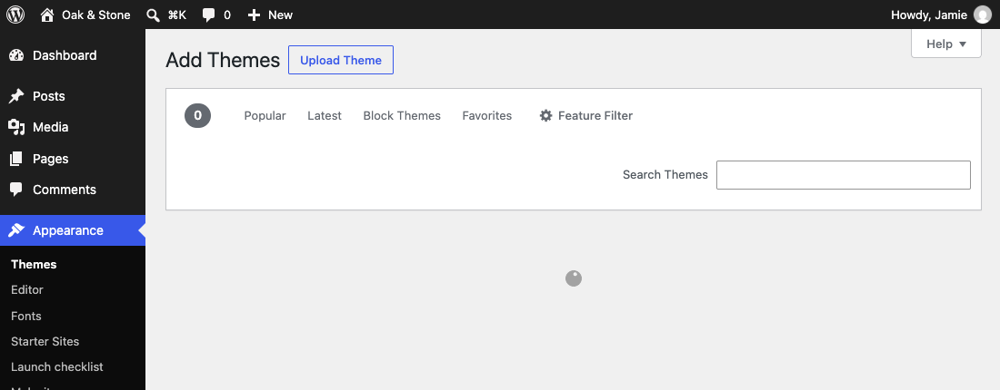
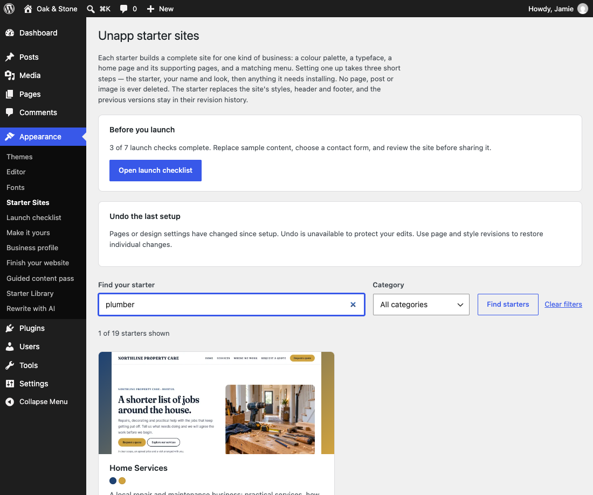
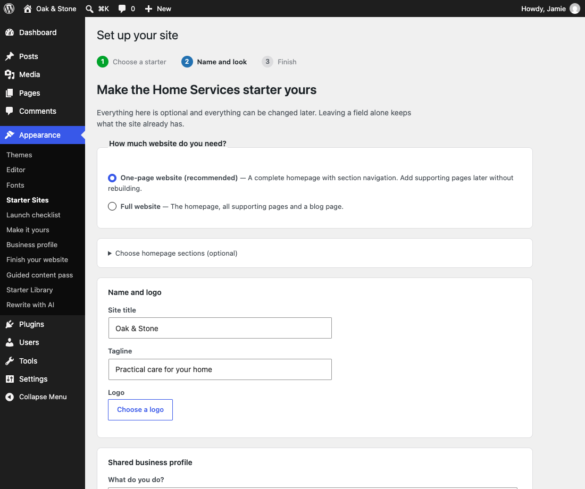
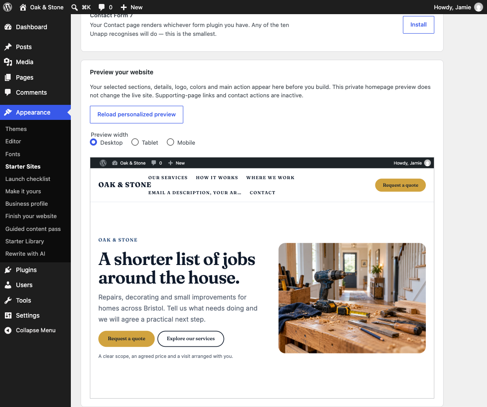
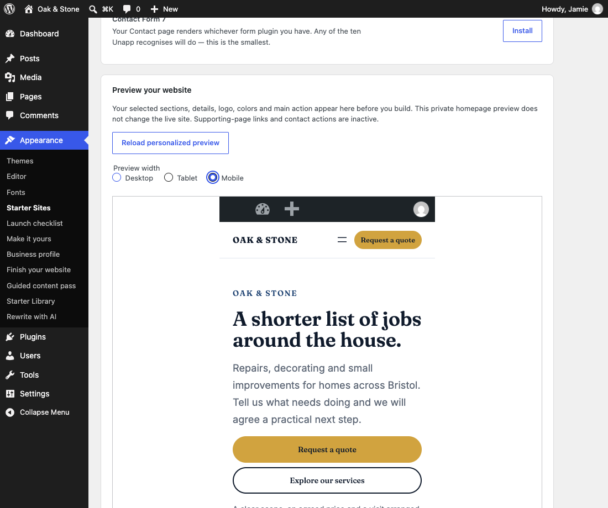
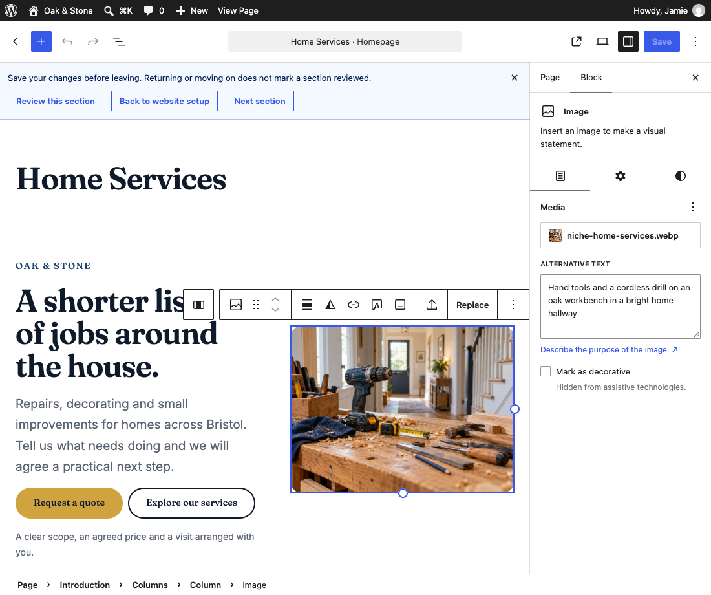
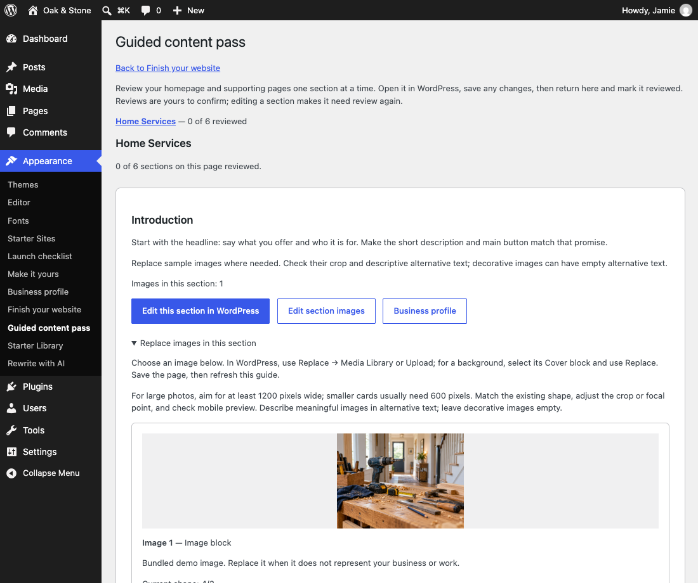
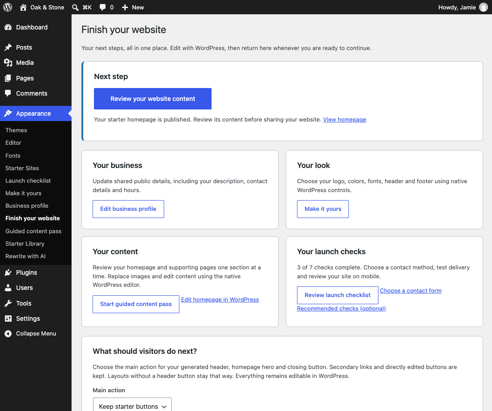

Start here · Unapp 2.6

# Your website, step by step

Choose a starter. Make it yours. Review it in WordPress. Follow the screenshots below to go from a fresh theme to a website you are ready to share.

19 free startersNative WordPress editingNo paid plugin required

<nav class="guide-steps" aria-label="Getting started steps"><a href="#install"><b>01</b> Install</a><a href="#choose"><b>02</b> Choose</a><a href="#personalize"><b>03</b> Personalize</a><a href="#preview"><b>04</b> Preview</a><a href="#edit"><b>05</b> Edit</a><a href="#launch"><b>06</b> Launch</a></nav>

[Watch the short starter walkthrough](https://docs.colorlib.com/unapp/img/getting-started/starter-walkthrough.mp4). The video has action captions; the screenshots below explain the same steps.

<h2 id="install">01 Install Unapp</h2>

Download the [theme ZIP from Colorlib](https://colorlib.com/wp/themes/unapp/). In WordPress, open **Appearance → Themes → Add New → Upload Theme**. Choose the ZIP, select **Install Now**, then **Activate**. Use WordPress 6.6+ and PHP 7.4+.

Upload the installable theme ZIP, rather than the GitHub source-code archive.

<h2 id="choose">02 Find a starter that fits</h2>

Open **Appearance → Starter Sites**. Search by your business type or use a category. Choose **Preview** to explore a design, or **Set up this starter** to begin. [Browse all 19 live demos](https://docs.colorlib.com/unapp/starters/) if you are still deciding.

Try words such as plumber, photographer, charity or barber. Only Shop requires WooCommerce.

<h2 id="personalize">03 Make it yours</h2>

Keep **One-page website** for a quick start, or choose **Full website** for supporting pages. Enter your name, description, logo and public contact details. Optional controls let you change services, sections, colors, fonts and the main button. Choose **Continue**.

Start with your name and a clear description. You can change the optional choices later.

<h2 id="preview">04 Check it before you build</h2>

Your personalized homepage appears on **Review and build your website**. Check **Desktop**, **Tablet** and **Mobile**. Use **Back** to adjust anything, then choose **Build my site** when the choices look right.

Previewing leaves your live site unchanged. Build my site creates published starter content and changes your front page.

See the mobile preview

Use the device controls before applying the starter; also check your real phone before launch.

<h2 id="edit">05 Add your words and photos</h2>

Open **Appearance → Finish your website → Start guided content pass**. Work through the homepage and any supporting pages. Use **Edit this section in WordPress** or a **Replace image … in WordPress** link. In the editor, select a photo and choose **Replace → Upload** or **Media Library**.

Save your edits, then use Review this section to return. Choose Reviewed, continue in the guide when you are satisfied.

See the guided content screen

The guide remembers your progress. Returning from the editor does not mark a section reviewed automatically.

<h2 id="launch">06 Finish, check and share</h2>

Return to **Appearance → Finish your website**. Review your business details and main action, replace remaining examples, and open the launch checklist. Test your contact method and mobile menu. Site icon, navigation, search visibility and image descriptions are optional finishing recommendations.

Your starter is already published after building. Review it before sharing; change search visibility in WordPress when you are ready.

<h2>Keep building at your own pace</h2>
You can return to <strong>Finish your website</strong> whenever you like. One-page sites can add supporting pages later. Existing content stays available when you apply another starter.

<a class="btn" href="setup-reference.md">Detailed setup reference</a><a class="btn ghost" href="https://docs.colorlib.com/unapp/starters/">Explore the starters</a>

Need help? The reference covers Undo, service cards, section swaps, header/footer presets, contact forms and launch checks.

